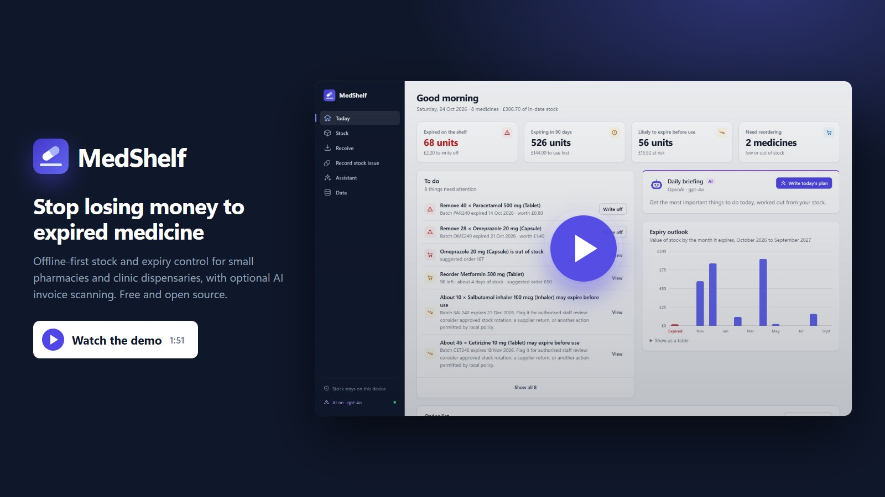
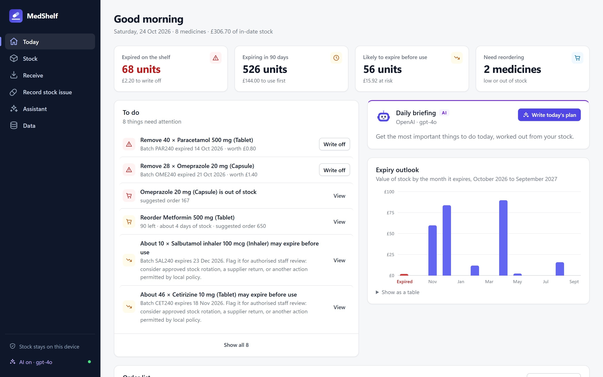
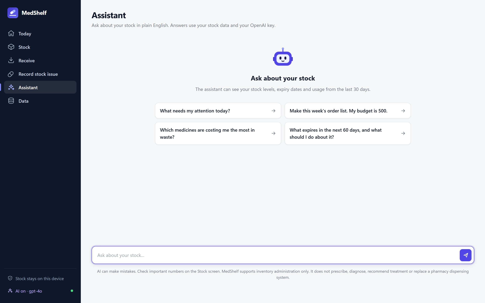
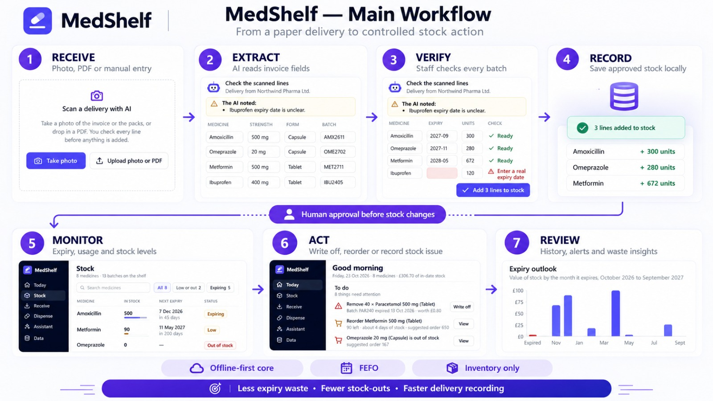
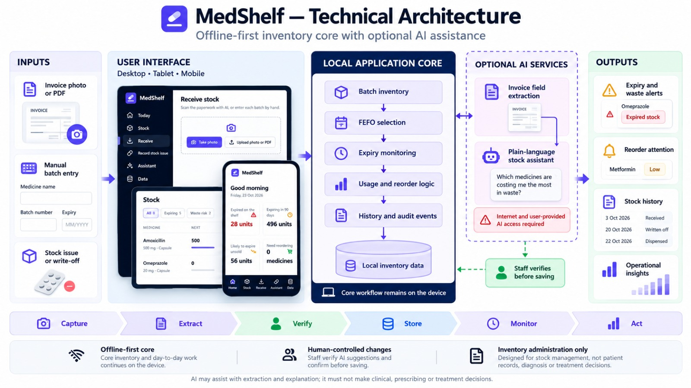

<div align="center">


# MedShelf

**Offline-first medicine stock and expiry control for small pharmacies and clinic dispensaries.**

[**Live demo**](https://talhaali-tech-engineer.github.io/MedShelf/) &nbsp;·&nbsp; [**Watch the video**](https://talhaali-tech-engineer.github.io/MedShelf/docs/medshelf-demo.mp4) &nbsp;·&nbsp; [Installation](#installation) &nbsp;·&nbsp; [Main workflow](#main-workflow) &nbsp;·&nbsp; [Architecture](#technical-architecture)

[](https://github.com/talhaali-tech-engineer/MedShelf/actions/workflows/test.yml)


</div>

MedShelf is an offline-first medicine stock and expiry-control prototype for small independent pharmacies and clinic dispensaries. It helps staff record deliveries, monitor batches, reduce avoidable expiry waste and identify potential stock-outs. Optional AI features assist with invoice extraction and stock questions, while final decisions remain with authorised staff.

> **Scope:** MedShelf supports inventory administration only. It does not prescribe, diagnose, recommend treatment or replace a pharmacy dispensing system.

<div align="center">
<a href="https://talhaali-tech-engineer.github.io/MedShelf/docs/medshelf-demo.mp4"></a>
</div>

## Contents

[Problem](#problem) · [Target customer](#target-customer) · [Product solution](#product-solution) · [Demo video](#demo-video) · [Screenshots](#screenshots) · [Main workflow](#main-workflow) · [Technical architecture](#technical-architecture) · [Offline versus AI-cloud boundary](#offline-versus-ai-cloud-boundary) · [Installation](#installation) · [Generated demo data](#generated-demo-data) · [Tests](#tests) · [Limitations](#limitations) · [Validation roadmap](#validation-roadmap)

## Problem

Small pharmacies and clinic dispensaries run on thin margins and, often, paper records. The same three things go wrong every week:

- **Medicine expires on the shelf.** Nobody notices a batch is close to its date until it has passed, and its value is lost.
- **Needed medicines run out.** Without a clear usage rate, reordering is guesswork.
- **Recording deliveries is slow.** Every invoice has batch numbers, expiry dates, pack sizes and prices. They are easy to mistype, so many teams stop recording batches at all, which makes the first two problems worse.

Large chains solve this with expensive inventory systems. Small independent sites, often with unreliable internet, usually can't.

## Target customer

| | |
| --- | --- |
| **Primary** | Independent community pharmacies |
| **Secondary** | Small clinic dispensaries |
| **Later** | Care providers holding approved medical stock |

## Product solution

MedShelf is a batch-level inventory system, not a generic stock app. It is built around how medicines are actually stored:

- **Batches and expiry dates.** Every delivery is recorded as batches, each with its own batch number, expiry date, quantity, pack strength, form and cost.
- **FEFO (first expiry, first out).** When units are recorded as issued, they always come from the in-date batch that expires soonest. Expired stock is never used.
- **A daily to-do list.** It ranks what to remove, what to reorder and what to use first.
- **Waste-value calculation.** From the last 30 days of usage, it shows which batches are likely to expire before they are used, and what they are worth, while there is still time to act.
- **Stock-out prediction.** Each medicine is flagged when stock will run out before a delivery could arrive. A suggested order quantity is downloadable as a CSV for the supplier.
- **Medicine-specific alerts.** Expired, expiring, low, out-of-stock and waste-risk states, with an expiry outlook for the next 12 months.
- **Invoice scanning with human review (optional AI).** A photo or PDF of the supplier invoice is read into stock lines. Pack sizes are converted to units in code, lines are matched to stocked medicines, and unclear fields are flagged. **Nothing is saved until staff have checked every line.**
- **Stock questions in plain English (optional AI).** For example: "Which medicines are costing me the most in waste?" For stock at risk of expiring, the assistant recommends flagging the batch for authorised staff review, approved stock rotation, or a supplier return. It never recommends promoting or selling medicine.

## Demo video

A two-minute walkthrough of every feature: [**watch it here**](https://talhaali-tech-engineer.github.io/MedShelf/docs/medshelf-demo.mp4).

The AI answers in the video are real GPT-4o responses, generated on the same demo data that the video shows.

## Screenshots



<table>
  <tr>
    <td></td>
    <td></td>
  </tr>
  <tr>
    <td align="center"><sub>Staff check scanned invoice lines before anything is saved</sub></td>
    <td align="center"><sub>The optional stock assistant</sub></td>
  </tr>
</table>

## Main workflow



1. **Receive.** Photograph or upload the invoice, or enter the batch by hand.
2. **Extract** (optional AI). Invoice fields are read into editable lines.
3. **Verify.** Staff check every line. Unclear fields block saving until they are fixed.
4. **Record.** Approved lines are saved as batches on the device.
5. **Monitor.** Expiry dates, usage and stock levels are tracked continuously.
6. **Act.** Write off expired stock, reorder, or record a stock issue.
7. **Review.** History, alerts and waste insights.

## Technical architecture



- **Local application core.** Batch inventory, FEFO selection, expiry monitoring, usage and reorder logic, and a history of every stock movement. All of it runs in the browser on the device (`js/core.js`, pure and tested), with data in IndexedDB.
- **User interface.** Plain HTML, CSS and JavaScript modules. One responsive app for desktop, tablet and mobile, installable as a progressive web app.
- **Optional AI services.** OpenAI or Claude, called directly from the browser with the user's own API key (`js/ai.js`, tested with a fake server). AI suggestions never change stock; staff verify before anything is saved.
- **No server, no build step and no dependencies.**

## Offline versus AI-cloud boundary

Core stock management works offline. Optional cloud-AI features require an internet connection and the user's own API credentials.

| Works offline, on the device | Needs internet and your own API key |
| --- | --- |
| Receiving stock by hand, batches and expiry dates | Invoice scanning (AI extraction) |
| FEFO stock issues and write-offs | Daily briefing |
| Expiry, waste-risk and reorder alerts | Stock assistant questions |
| Stock list, history, charts | |
| CSV import and export, backup and restore | |

**What leaves the device, and when.** Nothing, unless an AI feature is used. When one is, the stock list (medicine names, quantities, expiry dates and costs), or the invoice photo being scanned, is sent directly to the chosen AI provider. **Stock-issue notes are never sent**, and the API key is never written into backups.

## Installation

**Try it now:** open the [live demo](https://talhaali-tech-engineer.github.io/MedShelf/) and press **Try it with sample data**.

**Run it on your own computer.** You need [Node.js](https://nodejs.org) 20 or newer; there is nothing else to install.

```bash
git clone https://github.com/talhaali-tech-engineer/MedShelf.git
cd MedShelf
npm start
```

Then open http://localhost:8080.

**Turn on AI (optional).** Open **Data → Assistant**, paste an [OpenAI](https://platform.openai.com/api-keys) or [Claude](https://console.anthropic.com/settings/keys) API key, press **Test connection**, then **Save**. The key stays in that browser only.

**Host your own copy.** Fork the repository, go to **Settings → Pages**, choose **Deploy from a branch**, and pick `main` and `/ (root)`.

## Generated demo data

Everything in the demo is fictional and generated. No real pharmacy, supplier, patient or invoice data is included in this repository.

- **Try it with sample data** creates 8 common medicines with batches, expiry dates and a month of usage history. Dates are generated relative to today, so every alert state (expired, expiring, low, waste risk) is always visible.
- [`docs/sample-invoice.png`](docs/sample-invoice.png) is a made-up supplier invoice ("Northwind Pharma Ltd") for trying invoice scanning with your own key.
- Spreadsheet import uses this CSV format. Only `name`, `expiry` and `qty` are required.

| name | strength | form | batch | expiry | qty | unit_cost | reorder_level |
| --- | --- | --- | --- | --- | --- | --- | --- |
| Paracetamol | 500 mg | Tablet | PCM2401 | 03/2027 | 500 | 0.02 | 200 |

## Tests

```bash
npm test
```

29 tests run on Node's built-in test runner, on every push, via GitHub Actions. They cover:

- FEFO selection, expiry parsing, usage rates, waste risk and reorder maths
- receiving, issuing and writing off stock
- CSV import (including spreadsheet-formula protection) and backup validation
- both AI providers' request and response formats, streaming, error messages that never repeat the key, pack-to-unit conversion of scanned invoices, and matching scanned lines to stocked medicines
- that the assistant is held to inventory work and never told to promote medicine
- that stock-issue notes are never included in AI requests

The AI tests use a fake server, so they need no API key and cost nothing.

## Limitations

- **Prototype status.** MedShelf has not yet been used in a live pharmacy. See the validation roadmap.
- **One device per site.** Data is not yet synced between devices; backups move it.
- **Browser storage.** Clearing the browser's site data deletes the stock. Weekly backups are prompted, but not enforced.
- **Not a regulated system.** MedShelf supports inventory administration only. It does not prescribe, diagnose, recommend treatment or replace a pharmacy dispensing system, and it does not replace physical stock checks or controlled-drug registers.
- **AI can be wrong.** That is why every scanned line needs staff confirmation, and why AI never changes stock by itself.

## Validation roadmap

1. **Workflow validation** with two or three independent pharmacies, using demo data: is the daily to-do list the right set of jobs?
2. **Invoice extraction accuracy** measured on consented, anonymised supplier invoices: correct fields per line, and how often staff need to fix something.
3. **Usability testing** on the phones and shared PCs that sites actually use.
4. **Security and data-protection review** before any real stock data is entered.
5. **Multi-device sync** for sites with more than one till or room.
6. **Controlled pilot** at one site, measuring expired-stock value and stock-outs before and after.

## Contributing

Issues and pull requests are welcome. Please run `npm test` before opening a pull request. Never commit API keys, `.env` files, real invoices, patient or customer data, or local databases.

## Author

Created by **Talha Ali** ([@talhaali-tech-engineer](https://github.com/talhaali-tech-engineer)).

## Licence

[MIT](LICENSE)
