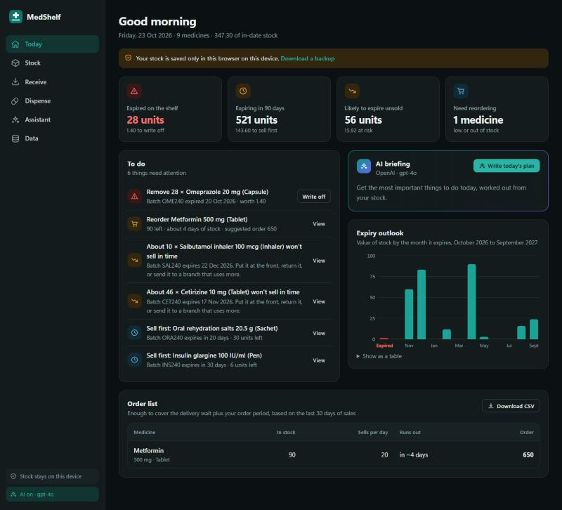
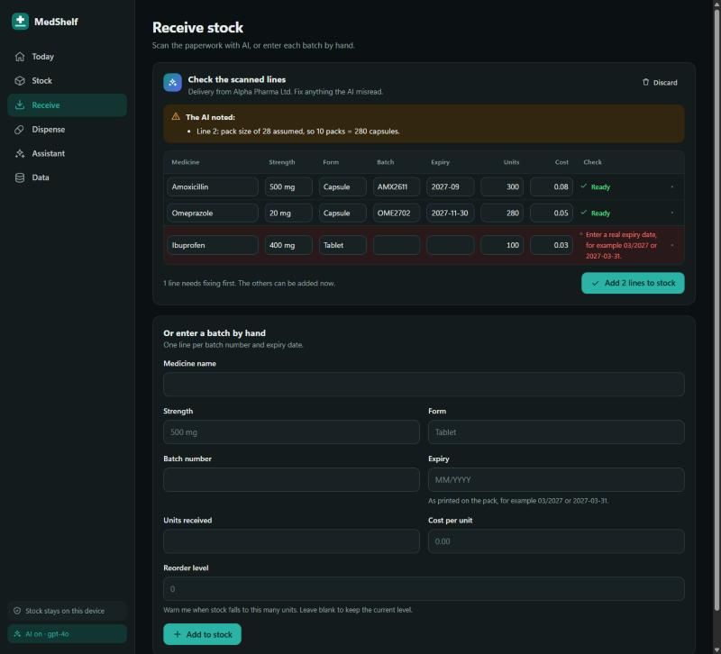

# MedShelf

**A free, AI-powered medicine stock and expiry tracker for small pharmacies and clinics. It runs in the browser, works offline, and keeps your stock data on your own device.**

Small pharmacies and clinics lose real money to medicine that expires on the shelf. They also run out of the medicines people need most. Most of them track stock on paper or in a spreadsheet, and neither one warns you before it's too late. MedShelf does, and its AI does the typing for you.

**Try it:** https://talhaali-tech-engineer.github.io/MedShelf/ (press *Try it with sample data*)



## What it does

- **Sells the oldest stock first.** Every delivery is stored as batches with expiry dates. Dispensing always takes the in-date batch that expires soonest, and never touches expired stock.
- **Gives you a daily to-do list.** It tells you what to take off the shelf, what to reorder, and what to sell first, and ranks the jobs by urgency.
- **Predicts waste before it happens.** From the last 30 days of sales, it works out which batches will expire before they sell. That leaves time to move them to the front, return them, or send them to a branch that uses more.
- **Suggests what to order and how much.** It covers the delivery wait plus a month of sales, and downloads the list as a CSV for your supplier.
- **Shows an expiry outlook.** A chart shows how much stock expires each month for the next year.
- **Imports your spreadsheet and keeps backups.** You can import a CSV, export stock and history, and back up and restore everything.
- **Works offline,** and installs like an app on a phone or PC.

### AI features (optional, with your own key)

- **Scan a delivery.** Photograph the supplier invoice or the packs, or upload a PDF. The AI reads every line: name, strength, form, batch, expiry, quantity and cost. It matches lines to medicines you already stock, flags anything it couldn't read, and **you check every line before anything is saved.**
- **Today's briefing.** A short, ranked plan for the day, written from your actual stock numbers.
- **Assistant.** Ask about your stock in plain English, for example "Make this week's order list within a budget of 500" or "Which medicines are costing me the most in waste?"



The AI works with **OpenAI** keys (default model `gpt-4o`) and **Claude** keys from Anthropic (default model `claude-opus-5-5`). MedShelf works out which one you have from the key itself. You can change the model in **Data → AI**.

**Guardrails**
- The AI never changes your stock. Scanned lines wait for you to confirm, and the assistant can only advise.
- It answers from your stock data only. It is told not to give dosing, diagnosis or treatment advice, and never to suggest dispensing expired medicine.
- Text on scanned paperwork is treated as data, not instructions.

## Privacy

- There is no server and no account. Your stock lives in your browser's own database (IndexedDB) on your device.
- Your AI key is saved only in that browser. It is never written into backups, and it is only ever sent to your AI provider.
- An AI feature sends data only when you use it. It sends your stock list (medicine names, quantities, expiry dates and costs) or the photo you scanned, straight from your browser to OpenAI or Anthropic, billed to your account.
- **Notes typed when dispensing are never sent to the AI,** because they can hold prescription numbers or patient initials.
- A Content Security Policy only lets the page talk to itself and to the two AI providers.

## Run it on your own computer

You need [Node.js](https://nodejs.org) 20 or newer. There is nothing to install.

```bash
git clone https://github.com/talhaali-tech-engineer/MedShelf.git
cd MedShelf
npm start
```

Then open http://localhost:8080. Any static web server works too. Opening `index.html` straight from the disk does not work, because browsers block JavaScript modules on `file://`.

To turn on AI, open **Data → AI**, paste your key, press **Test connection**, then **Save**. You can get a key from [OpenAI](https://platform.openai.com/api-keys) or [Anthropic](https://console.anthropic.com/settings/keys).

## Put it online for free

MedShelf is static files only, so GitHub Pages can host it. Fork this repository, go to **Settings → Pages**, choose **Deploy from a branch**, then pick `main` and `/ (root)`. Each person who opens the link keeps their own data and their own AI key on their own device.

## Importing a spreadsheet

Save your stock list as CSV with these columns. Only `name`, `expiry` and `qty` are required.

| name | strength | form | batch | expiry | qty | unit_cost | reorder_level |
| --- | --- | --- | --- | --- | --- | --- | --- |
| Paracetamol | 500 mg | Tablet | PCM2401 | 03/2027 | 500 | 0.02 | 200 |

`expiry` can be `2027-03-31`, `2027-03`, `03/2027` or `03/27`. A month on its own means the last day of that month. Rows with problems are listed by row number and are not imported.

## Back up your data

Data lives in one browser on one device. Clearing the browser's site data, or losing the device, loses the stock. Go to **Data → Download backup** every week. The Today screen reminds you when your last backup is more than a week old.

## How the numbers are worked out

- **Expiry:** the expiry date is the last day a batch can be dispensed.
- **Sales rate:** units dispensed in the last 30 days, divided by 30. A medicine stocked more recently is averaged over the days it has been stocked, but never fewer than 7.
- **Waste risk:** batches are used in expiry order at the current sales rate. Units left in a batch on its expiry date are at risk. This needs two weeks of history for a medicine.
- **Reorder:** stock is low when it is zero, at or below the reorder level, or will last no longer than the delivery time. The suggested order covers the delivery time plus the cover period (30 days by default), and is never less than twice the reorder level. You can change both periods in Settings.

## Development

```bash
npm test               # logic and AI tests, using Node's built-in test runner
npm start              # serves the app at http://localhost:8080
python scripts/make_icons.py   # redraws the PNG icons
```

There are no dependencies and no build step: plain HTML, CSS and JavaScript modules. The AI tests use a fake server, so they need no key and cost nothing.

```
index.html            page shell and Content Security Policy
css/styles.css        design system, light and dark mode
js/core.js            stock, expiry, reorder, CSV and backup logic (pure, tested)
js/ai.js              OpenAI and Claude requests, streaming, invoice reading (tested)
js/app.js             screens
js/chart.js           expiry outlook chart
js/ui.js, icons.js    DOM helpers, safe Markdown rendering, icons
js/db.js              IndexedDB storage
js/sample.js          sample data for trying it out
sw.js                 offline cache
tests/                Node tests
```

When you change any app file, bump `CACHE` in `sw.js`, so people's devices get the new version.

## Limits

- One device per shop. Data is not shared between devices yet; use backups to move it.
- It is a stock tool. It is not a dispensing record for prescriptions or a medical device, and it does not replace physical stock checks. AI readings can be wrong, which is why every scanned line needs your confirmation.

## Ideas for later

- Sync between devices in the same shop
- Barcode scanning with the phone camera
- Supplier list and purchase orders
- Printable shelf labels and stock-count sheets

Issues and pull requests are welcome.

## Licence

[MIT](LICENSE)
